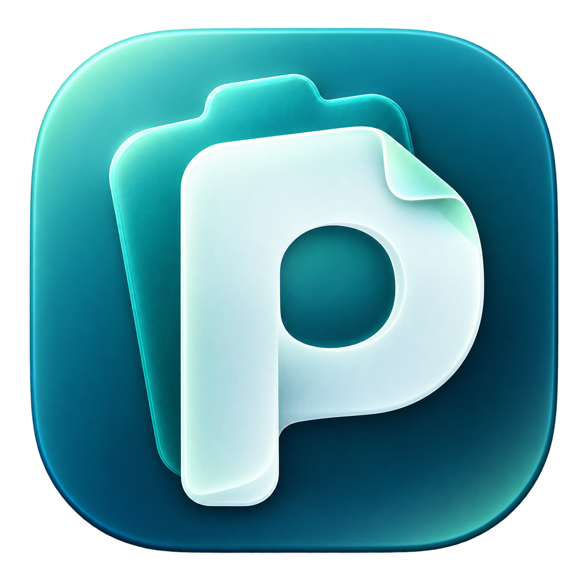
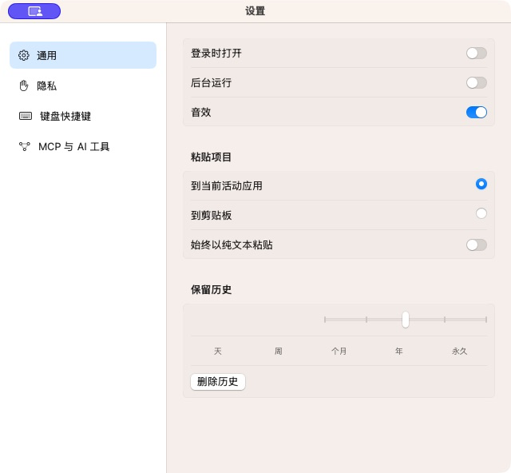

<p align="center"><a href="README.md">简体中文</a> · <strong>English</strong></p>

<p align="center">
  
</p>

# Pasto

**A free, local clipboard manager for macOS.** Save what you copy, browse it as cards, and search and organize content you use often.

Pasto supports **macOS 14+, Intel (x86_64), and Apple silicon (arm64)**. It is built with Swift, AppKit, and SwiftUI and needs no account from the original vendor. Optional [iCloud Drive file sync](docs/ICLOUD_SYNC.md) is off by default. The source also retains [CloudKit migration code](docs/CLOUDKIT_MIGRATION.md) requiring signing configuration. Check each installer’s release notes for its features. Both linked guides are in Chinese.

[](https://github.com/yingyanzhitong/pasto/actions/workflows/release.yml)

[Website](https://yingyanzhitong.github.io/pasto/) · [Download latest](https://github.com/yingyanzhitong/pasto/releases/latest) · [Feature comparison](#paste-vs-pasto) · [Build from source](#build-from-source) · [Contribute](CONTRIBUTING.md) · [License scope](NOTICE.md)

The website and download information below are updated by GitHub Actions after a stable Release is published.

## Version 1.0.8 search interaction fixes

Fixes a transparent input layer intercepting clicks on the panel's search icon. The button follows the original native action path, activating search and input focus during the click action. Click the icon or press ⌘F inside the panel to search.

Targeted checks use isolated synthetic data on Apple silicon with macOS 26.2 and SDK 26.5. They cover 27 hit points, three mouse and keyboard cycles, filtering, and repeated transitions. Clicking and typing in the installed app also passed. Native Intel hardware and older macOS versions remain untested. Ad-hoc signed updates may still need Accessibility access enabled again.

## Version 1.0.7

This release gives 1.0.6 users a newer version to test in-app updates. Open **About Pasto → Check for Updates → Download and Install** to upgrade to 1.0.7. Accessibility access may still need to be enabled again after updating.

## Version 1.0.6 in-app updates

Version 1.0.6 adds **Check for Updates** and **Download and Install** to **About Pasto**. Opening About checks the latest stable GitHub Release asynchronously and reuses results for six hours. After confirmation, Sparkle downloads the complete Universal DMG, verifies Ed25519 signatures on the update feed and archive, installs it, and relaunches Pasto. The existing quit flow saves local data before installation. Ad-hoc signed updates may still require macOS Accessibility access to be enabled again.

The request contains only public release information. Offline and failed checks can be retried while clipboard features remain available. **Published installers through 1.0.5 do not contain this entry. Install 1.0.6 or a newer version manually first.**

A local isolated app completed a real Sparkle download, installation, and relaunch, but lost Accessibility authorization after the update. See the [test record](reports/replica/in-app-update-accessibility-test-2026-11-04.md) (Chinese).

## Version 1.0.5 compatibility fixes

Fixes resource-loading crashes when opening Settings after installation and failures importing some Paste collections. Updates resource lookup, older-system appearance branches, and universal packaging while preserving existing local history and collections.

Targeted arm64 and Rosetta x86_64 tests passed. Older macOS releases and native Intel hardware still need testing. Upgrade legacy v4/v5-old databases with a current Paste version before importing. See the [compatibility migration report](reports/replica/paste-compatibility-migration-2026-11-04.md) (Chinese).

## Screenshots

Actual app screenshots using isolated sample data, with no real clipboard history. The app interface shown is in Chinese.

Clipboard panel:


Settings:



## Features implemented in the source

- Clipboard history that preserves multiple content formats: text, images, files, links, and colors.
- A horizontal card panel, search and filters, multiple selection, previews, and local editing.
- Collections (Pinboard), a Pasto Stack queue, and archive import and export.
- Migration of local collections and their contents from Paste, preserving colors and order. Repeated imports do not overwrite existing edits. Open the More menu → Import collections from Paste…; see the [migration guide](replica/README.md#从-paste-迁移分组) (Chinese).
- Global keyboard shortcuts, configurable plain-text actions, recording pause, and local settings.
- Local Vision OCR and a separate `pasto-mcp` stdio service.

**Pasto is an independent implementation in development. Full one-to-one verification against the original is not complete.** The list above means source code and feature entry points exist; it does not mean every interaction or edge case has been verified. Cross-app direct paste has not been fully verified, so correct insertion at the cursor cannot be guaranteed in every app. When reporting copy or paste issues, include reproduction steps without private content.

## Paste vs. Pasto

**Pasto is free and open source, focused on local use on Mac.** ✅ Available · ❌ Not available

| Core feature | Paste | Pasto |
| --- | :---: | :---: |
| Clipboard history and content previews | ✅ | ✅ |
| Search and filters | ✅ | ✅ |
| Collections | ✅ | ✅ |
| Single and batch copy and paste | ✅ | ✅ |
| Sequential paste with Stack | ✅ | ✅ |
| Text recognition in images (OCR) | ✅ | ✅ |
| Custom keyboard shortcuts | ✅ | ✅ |
| AI tool integration (MCP) | ✅ | ✅ |
| Apple Shortcuts | ✅ | ❌ |
| iCloud sync between Macs | ✅ | ✅ |
| iPhone / iPad apps | ✅ | ❌ |
| Shared collections and collaboration | ✅ | ❌ |
| Online link previews | ✅ | ❌ |

Pasto also supports [importing local collections from Paste](replica/README.md#从-paste-迁移分组). ✅ means implemented; full interactions and cross-app paste still need comprehensive verification. See the [feature and testing scope](replica/TESTING.md) (Chinese). This comparison covers Paste 6.6.6 and Pasto 1.0.5. For Paste's sync and collaboration features, see the [Paste website](https://pasteapp.io/).

## iCloud sync

The primary option is **iCloud Drive file sync**, which does not require a paid developer membership. Turn on **iCloud sync** in **Settings → General**. Pasto automatically uses `iCloud Drive/Pasto`, with no folder picker or setup dialog. Use the same Apple ID and enable the switch on another Mac. It merges clipboard history, original content, and collections, including additions, edits, and deletions. It is off by default. See the [usage and verification guide](docs/ICLOUD_SYNC.md) (Chinese).

Properly signed builds can also show an advanced option migrated from the original CloudKit flow, using Pasto's own container and disabled by default. Valid Apple signing credentials and container configuration are currently missing, and live CloudKit testing is incomplete. It does not connect to the original vendor's cloud data or provide mobile apps or shared collaboration.

CloudKit remains an advanced option for properly signed builds and cannot run alongside file sync. File upload results do not verify CloudKit behavior. See the [CloudKit notes](docs/CLOUDKIT_MIGRATION.md) (Chinese) for migration evidence, isolated tests, and outstanding work. Pasto uses iCloud Drive file sync. End-to-end sync across real devices still needs full validation.

## Download and use

Download from the [latest stable Release](https://github.com/yingyanzhitong/pasto/releases/latest) and read its limitations. The installer is ad-hoc signed and has not been notarized by Apple.

<!-- pasto-download:start -->
Current stable version: **1.0.8**. One installer supports Intel and Apple silicon:

[Download Pasto-1.0.8-macos-universal.dmg](https://github.com/yingyanzhitong/pasto/releases/download/v1.0.8/Pasto-1.0.8-macos-universal.dmg)
<!-- pasto-download:end -->

The main app, Helper, and MCP executable all include both architectures. There is no need to choose a chip-specific download. Check each older release's notes for its package format and supported architectures.

Open the DMG and drag `Pasto.app` onto the adjacent `Applications` shortcut. Launch Pasto from Applications after copying, then eject the disk image in Finder. Do not run the app from the disk image for everyday use.

Direct paste into other apps requires macOS Accessibility access. Granting permission does not mean the feature has passed full compatibility testing.

Pasto stores clipboard content locally. Screenshots, logs, and archives may contain personal information; review them before sharing. Prefer fictional text and temporary files when reproducing an issue.

## Build from source

You need macOS 14+, an Intel or Apple silicon Mac, Xcode Command Line Tools (the Swift toolchain), and Python 3. Build with Xcode 26 or newer Command Line Tools for the native macOS 26 control design; the minimum runtime remains macOS 14. The first build downloads a checksum-pinned Sparkle binary framework through SwiftPM for in-app updates.

```sh
git clone https://github.com/yingyanzhitong/pasto.git
cd pasto
bash replica/scripts/build-app.sh
open replica/dist/Pasto.app
```

By default, the build creates a Universal app with Intel and Apple silicon architectures. Use `bash replica/scripts/build-app.sh debug native` to build a debug app for the current Mac only. The script creates `replica/dist/Pasto.app` with resources, a login helper, and the MCP executable, and checks local signatures.

Build one Universal DMG for both Apple silicon and Intel:

```sh
npm run build:dmg
```

This runs the release script's `release-ci.py package` command, builds both architectures, and combines them into one Universal DMG. To package an existing native-architecture app as a DMG:

```sh
bash replica/scripts/build-dmg.sh replica/dist/Pasto.app replica/dist/Pasto.dmg
```

DMG creation refuses to overwrite an existing destination file.

Compile for the current Mac without packaging an app:

```sh
swift build --package-path replica -c release
```

More development information is available in [replica/README.md](replica/README.md) and the [testing scope](replica/TESTING.md), both in Chinese.

## Automated builds and releases

Change `version` in the root `package.json` and push to `main` to trigger a GitHub Actions build and release when the version changes. You can also push a matching `v<version>` tag or run the workflow manually in Actions.

The workflow keeps a native Intel build check, then validates the Universal package's version, both architectures in all three executables, and signatures. Stable releases publish four assets, including `Pasto-<version>-macos-universal.dmg`, `SHA256SUMS.txt`, `release-manifest.json`, and the signed `appcast.xml` feed. Stable publishing requires the `PASTO_UPDATE_PRIVATE_KEY` Actions Secret. See [in-app updates](docs/APP_UPDATES.md) (Chinese). The Release becomes public only after upload verification succeeds. Versions ending in `-dev.N` are prereleases; stable releases are marked as latest. A version does not overwrite artifacts from another commit, and failed runs do not publish a stable Release.

The `Source code (zip)` and `Source code (tar.gz)` links on a Release page are generated by GitHub for the tag. They are not installers or additional assets uploaded by this workflow.

After a stable Release is published successfully, Actions reads the latest uploaded Universal DMG, updates both READMEs and the website download buttons and version labels, then deploys GitHub Pages. Failed builds and prereleases do not replace the stable download.

See the [release workflow](.github/workflows/release.yml). A successful build and release does not imply successful functional regression testing.

## Project origins and verification limits

Pasto is independently rewritten using **Paste 6.6.6** static reverse-engineering evidence from REA / Ghidra. Decompiled pseudocode is not a directly buildable original Swift project. This project is not affiliated with or endorsed by the original vendor, and does not modify the original app or its licensing.

The existing original machine-code analysis and address evidence are from **arm64**. Providing one Universal DMG with both architectures does not mean the original x86_64 app has been decompiled or that all features have passed regression testing on Intel and Apple silicon.

See the [reverse-engineering notes](docs/REVERSE_ENGINEERING.md) for the research process and the [consolidated feature audit](reports/replica/fast-coverage-audit.md) for current evidence and remaining differences; both are in Chinese. Binary address counts, exported pseudocode counts, and registered implementation counts cannot be converted into a product completion percentage. A successful build, installation, or individual action also does not constitute full interaction verification.

## Open-source license

The independently written implementation, tools, documentation, and newly created Pasto icon are open source under the [MIT License](LICENSE). **This license does not cover decompiled output from the original app, recovered assembly, original localization resources, or other original materials.** See [NOTICE.md](NOTICE.md) for the scope and rights applicable to each part.
