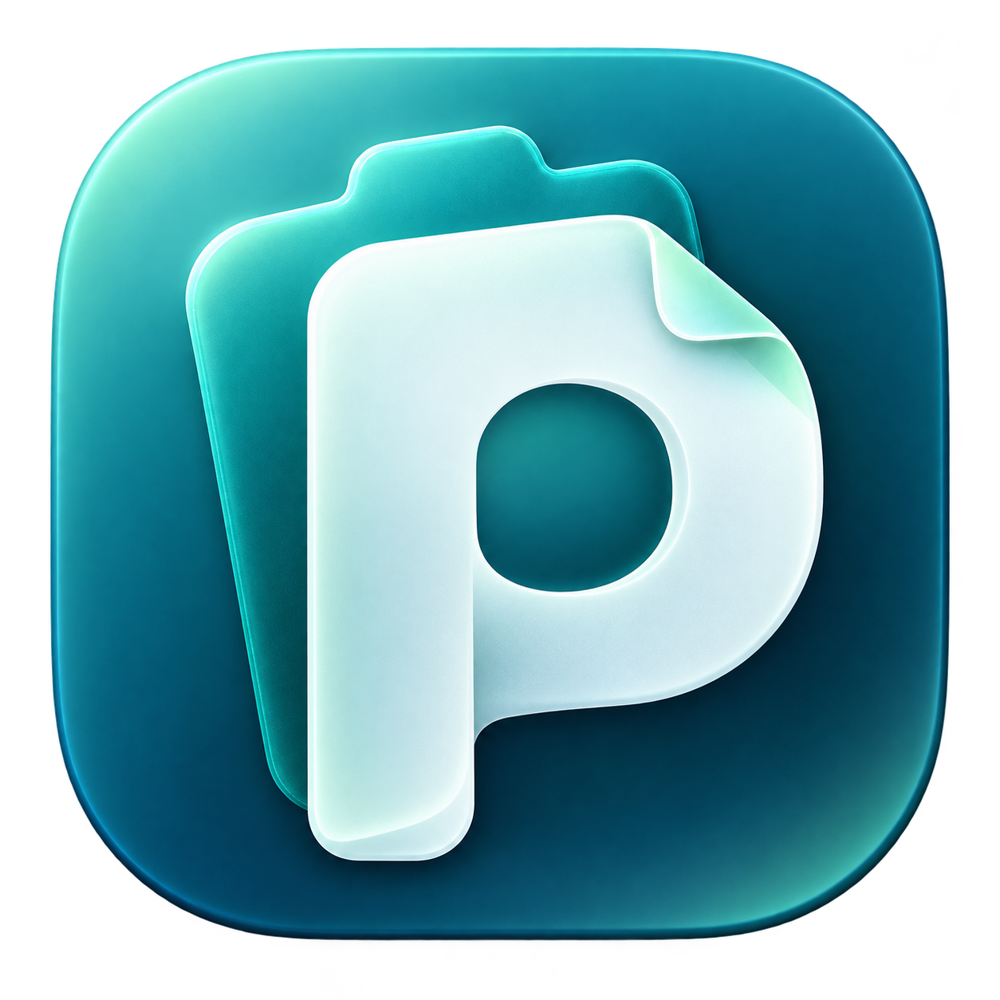
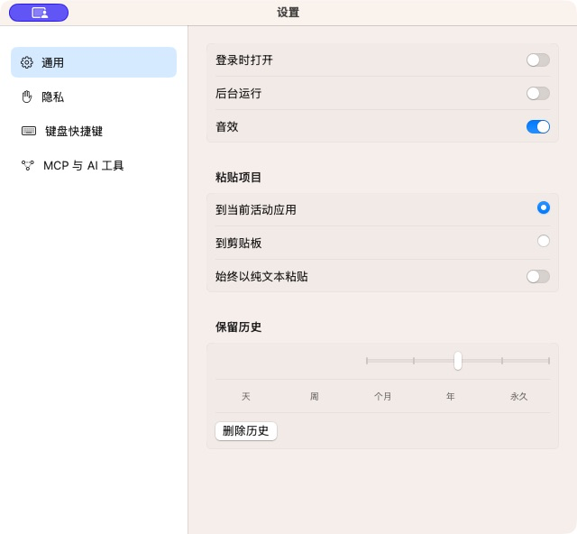

<p align="center"><strong>简体中文</strong> · <a href="README.en.md">English</a></p>

<p align="center">
  
</p>

# Pasto

**免费的本地 macOS 剪贴板工具。** 保存拷贝记录，用卡片浏览、搜索和整理常用内容。

Pasto 面向 **macOS 14+，支持 Intel（x86_64）和 Apple 芯片（arm64）**，使用 Swift、AppKit 和 SwiftUI。无需原厂账号。提供默认关闭的 [iCloud Drive 文件同步](docs/ICLOUD_SYNC.md)，并保留需配置签名的 [CloudKit 迁移代码](docs/CLOUDKIT_MIGRATION.md)。各安装包的实际功能以对应发布说明为准。

[](https://github.com/yingyanzhitong/pasto/actions/workflows/release.yml)

[官网](https://yingyanzhitong.github.io/pasto/) · [下载最新版](https://github.com/yingyanzhitong/pasto/releases/latest) · [功能对比](#paste-与-pasto-功能对比) · [源码构建](#源码构建) · [参与贡献](CONTRIBUTING.md) · [许可范围](NOTICE.md)

官网与下方下载信息会在正式 Release 发布成功后由 GitHub Actions 自动更新。

## 本次更新 · 1.0.6

1.0.6 在 **关于 Pasto** 中提供“检查更新”和“下载并安装”。打开关于窗口后异步比较 GitHub 最新正式 Release，六小时内复用结果，也可手动重新检查。确认更新后，Sparkle 在应用内下载完整的 Universal DMG，验证更新源和安装包的 Ed25519 签名，安装后重启应用。安装前会通过已有退出流程保存本地数据。临时签名版本更新后仍可能需要重新开启 macOS 辅助功能授权。

检查仅请求公开版本信息。离线或请求失败时可重试，剪贴板功能可继续使用。**1.0.5 及更早的已发布安装包尚无此入口，需要先手动安装 1.0.6。**

本机隔离应用已完成实际 Sparkle 下载、安装和重启，但更新后辅助功能授权丢失。[查看实测记录](reports/replica/in-app-update-accessibility-test-2026-11-04.md)。

## 1.0.5 兼容性修复

修复安装后打开设置时的资源加载闪退，以及部分 Paste 分组导入失败。补齐资源、旧系统外观和双架构打包兼容处理，保留本机已有历史及分组。

arm64 与 Rosetta x86_64 定向测试已通过，旧系统及 Intel 真机仍待复测。旧版 v4/v5-old 数据库请先用新版 Paste 升级。[查看兼容迁移报告](reports/replica/paste-compatibility-migration-2026-11-04.md)。

## 界面

以下为独立演示数据下的实际界面截图，不含真实剪贴板历史。

剪贴板面板：


设置：



## 源码中已有的功能

- 剪贴板历史与多格式内容保留，支持文本、图片、文件、链接和颜色。
- 横向卡片面板、搜索筛选、多选、预览和本地编辑。
- 收藏分组整理、Pasto Stack 队列、归档导入和导出。
- 从 Paste 迁移本地分组与组内内容，保留颜色和顺序；重复迁移不覆盖已有编辑。入口：更多 → 从 Paste 迁移分组…，详见[迁移说明](replica/README.md#从-paste-迁移分组)。
- 全局快捷键、可配置的纯文本操作、暂停采集与本地设置。
- 本地 Vision OCR，以及独立的 `pasto-mcp` stdio 服务。

**当前是开发中的独立实现，尚未完成与原版一比一的全面验收。** 上述项目表示已有源码和功能入口，不代表每个交互或边界都已验证。跨应用直接粘贴仍未完成验证，不能保证在所有应用的光标位置正确插入；复制与粘贴问题请附不含隐私的复现步骤。

## Paste 与 Pasto 功能对比

**Pasto 免费、开源，专注 Mac 本地使用。** ✅ 已提供 · ❌ 未提供

| 核心功能 | Paste | Pasto |
| --- | :---: | :---: |
| 剪贴板历史与内容预览 | ✅ | ✅ |
| 搜索与筛选 | ✅ | ✅ |
| 收藏分组 | ✅ | ✅ |
| 单条与批量复制、粘贴 | ✅ | ✅ |
| Stack 顺序粘贴 | ✅ | ✅ |
| 图片文字识别（OCR） | ✅ | ✅ |
| 自定义快捷键 | ✅ | ✅ |
| AI 工具接入（MCP） | ✅ | ✅ |
| 系统“快捷指令” | ✅ | ❌ |
| Mac 间 iCloud 同步 | ✅ | ✅ |
| iPhone / iPad 应用 | ✅ | ❌ |
| 分组共享与协作 | ✅ | ❌ |
| 联网链接预览 | ✅ | ❌ |

Pasto 另支持[从 Paste 迁移本地分组](replica/README.md#从-paste-迁移分组)。✅ 表示已有实现，完整交互及跨应用粘贴仍待全面验证，详见[功能与验证范围](replica/TESTING.md)。对照基于 Paste 6.6.6 及 Pasto 1.0.5；同步与协作介绍见 [Paste 官网](https://pasteapp.io/)。

## iCloud 同步

首选方式为 **iCloud Drive 文件同步**，无需付费开发者会员。在 **设置 → 通用** 打开 **iCloud 同步** 开关即可，自动使用 `iCloud Drive/Pasto`，无需选择目录或设置弹窗；其他 Mac 使用同一 Apple ID 并开启相同开关。支持历史、原始内容与收藏分组的合并、新增、编辑和删除。默认关闭，具体范围与验证记录见 [使用说明](docs/ICLOUD_SYNC.md)。

有效签名构建另可显示按原版 CloudKit 路径迁移的高级选项，使用 Pasto 自有容器，默认关闭。目前缺少有效 Apple 签名与容器配置，真实 CloudKit 云端测试尚未完成。它不连接 Paste 原厂云数据，也不提供手机端或共享协作。

CloudKit 作为已配置签名构建的高级选项，与文件同步不能同时开启；文件上传记录不计作 CloudKit 验收。当前迁移证据、隔离测试与未完成项见 [CloudKit 说明](docs/CLOUDKIT_MIGRATION.md)。Pasto 使用 iCloud Drive 文件同步，跨设备真实同步仍待完整验收。

## 下载与使用

从 [最新正式 Release](https://github.com/yingyanzhitong/pasto/releases/latest) 下载，并阅读该版本的限制说明。安装包采用临时签名，尚未经过 Apple 公证。

<!-- pasto-download:start -->
当前正式版 **1.0.5**，一个安装包兼容 Intel 与 Apple 芯片：

[下载 Pasto-1.0.5-macos-universal.dmg](https://github.com/yingyanzhitong/pasto/releases/download/v1.0.5/Pasto-1.0.5-macos-universal.dmg)
<!-- pasto-download:end -->

主程序、Helper 和 MCP 均包含两种架构，无需选择芯片版本。历史版本的格式与架构范围以该版本的发布说明为准。

打开 DMG，将窗口中的 `Pasto.app` 拖到旁边的 `Applications` 快捷入口。复制完成后，从应用程序目录启动 Pasto，再在 Finder 中推出安装磁盘映像；不要直接从磁盘映像运行日常使用的应用。

跨应用直接粘贴需要 macOS 辅助功能权限；授权成功不等于该功能已通过完整兼容性验证。

Pasto 在本机保存剪贴板内容。截图、日志和归档可能包含个人信息，分享前请检查。报告问题时优先用虚构文本和临时文件复现。

## 源码构建

需要 macOS 14+、Intel 或 Apple 芯片 Mac、Xcode Command Line Tools（Swift 工具链）和 Python 3。为获得 macOS 26 的原生控件新外观，请使用 Xcode 26 或更新的 Command Line Tools 构建；运行最低版本仍为 macOS 14。首次构建通过 SwiftPM 下载校验固定版本的 Sparkle 二进制框架，用于应用内更新。

```sh
git clone https://github.com/yingyanzhitong/pasto.git
cd pasto
bash replica/scripts/build-app.sh
open replica/dist/Pasto.app
```

默认构建同时包含 Intel 与 Apple 芯片架构的 Universal 应用。可用 `bash replica/scripts/build-app.sh debug native` 仅构建当前 Mac 的调试应用。构建脚本生成 `replica/dist/Pasto.app`，包含资源、登录项辅助程序及 MCP 可执行文件，并进行本地签名检查。

一次构建同时兼容 Apple 芯片与 Intel 的 Universal DMG：

```sh
npm run build:dmg
```

该命令调用发布脚本 `release-ci.py package`，自动构建两个架构并合并为一个 Universal DMG。只为已有的本机应用制作 DMG：

```sh
bash replica/scripts/build-dmg.sh replica/dist/Pasto.app replica/dist/Pasto.dmg
```

制作 DMG 时，目标文件已存在会拒绝覆盖。

仅编译本机架构、不打包应用：

```sh
swift build --package-path replica -c release
```

更多开发说明见 [replica/README.md](replica/README.md) 和 [测试范围](replica/TESTING.md)。

## 自动构建与发布

修改根目录 `package.json` 的 `version` 并推送到 `main`，GitHub Actions 会在版本变化时自动构建和发布。也支持推送对应的 `v<版本号>` 标签，或在 Actions 页面手动运行。

工作流保留 Intel 原生构建检查，再校验 Universal 安装包的版本、三项可执行文件的双架构及签名，正式版发布四个附件，包含 `Pasto-<版本号>-macos-universal.dmg`、`SHA256SUMS.txt`、`release-manifest.json` 和签名更新源 `appcast.xml`。正式发布需配置 `PASTO_UPDATE_PRIVATE_KEY` Actions Secret，详见 [应用内更新](docs/APP_UPDATES.md)。上传校验成功后才公开 Release；`-dev.N` 版本标记为预发布，正式版本标为最新版本。同一版本不覆盖其他提交的产物，失败不会发布正式 Release。

Release 页面中的 `Source code (zip)` 和 `Source code (tar.gz)` 是 GitHub 自动提供的标签源码下载链接，不是安装包，也不是此发布流程额外上传的附件。

正式 Release 发布成功后，Actions 读取最新已上传的 Universal DMG，同步中英文 README、官网按钮和版本文案，再部署 GitHub Pages。构建失败或预发布版本不会替换正式版下载地址。

详见[发布工作流](.github/workflows/release.yml)。构建发布不代表功能回归通过。

## 项目来源与验证边界

Pasto 基于 **Paste 6.6.6** 的 REA / Ghidra 静态逆向证据独立重写；反编译伪代码不是可直接编译的原始 Swift 工程。本项目不隶属于或代表 Paste 原厂，不修改原版应用或其授权。

现有原版机器码分析与地址证据来自 **arm64**。Pasto 提供包含两个架构的单个 Universal DMG，不表示已反编译原版 x86_64，也不表示 Intel 与 Apple 芯片上的全功能回归均已通过。

研究过程见 [逆向研究说明](docs/REVERSE_ENGINEERING.md)；当前证据与剩余差异见 [集中功能核对报告](reports/replica/fast-coverage-audit.md)。二进制地址数量、伪代码导出数量和已登记实现数均不能换算为产品完成百分比；构建、安装和单项操作成功也不等于完整交互验收。

## 开源许可

独立编写的实现源码、工具、文档和新制作的 Pasto 图标按 [MIT License](LICENSE) 开源。**该许可不覆盖原应用的反编译产物、恢复汇编、原版本地化资源或其他原始素材。** 各部分范围及权利说明见 [NOTICE.md](NOTICE.md)。
