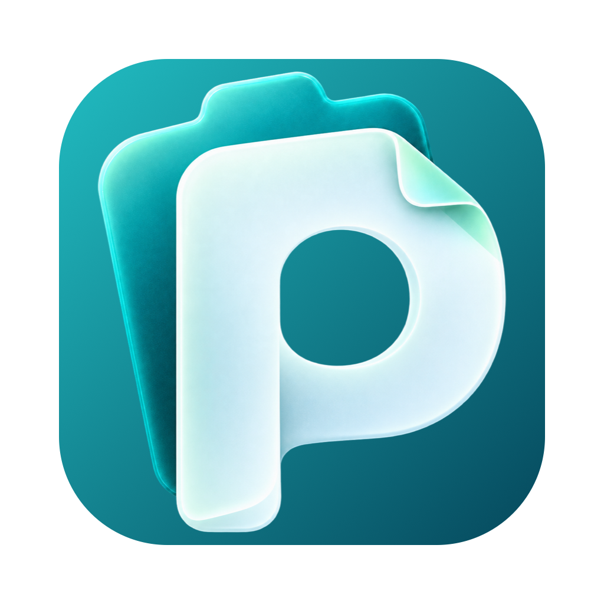
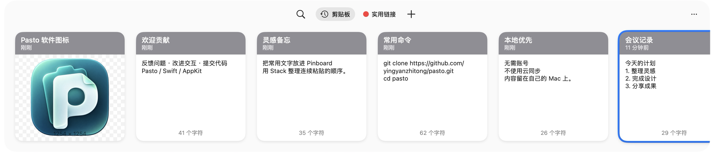
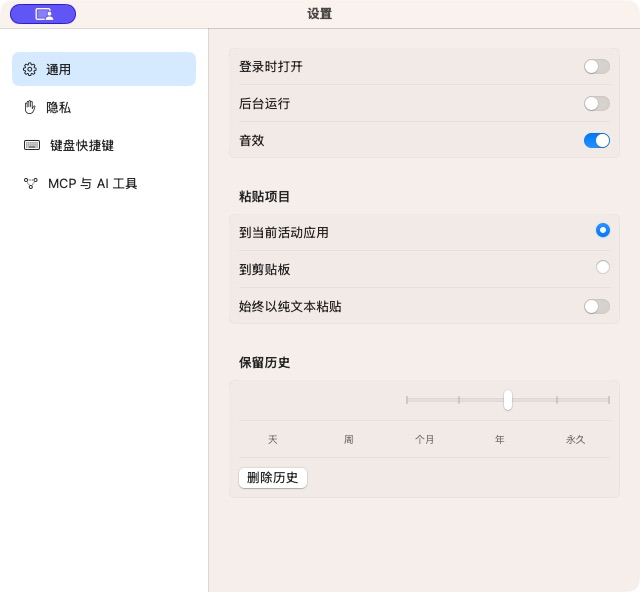

<p align="center">
  
</p>

# Pasto

**免费的本地 macOS 剪贴板工具。** 保存拷贝记录，用卡片浏览、搜索和整理常用内容。

Pasto 面向 **macOS 14+，支持 Intel（x86_64）和 Apple 芯片（arm64）**，使用 Swift、AppKit 和 SwiftUI。无需原厂账号，不实现 iCloud 或远程账号同步。

[](https://github.com/yingyanzhitong/pasto/actions/workflows/release.yml)

[下载预发布版本](https://github.com/yingyanzhitong/pasto/releases) · [源码构建](#源码构建) · [参与贡献](CONTRIBUTING.md) · [许可范围](NOTICE.md)

## 界面

以下为独立演示数据下的实际界面截图，不含真实剪贴板历史。

剪贴板面板：



设置：



## 源码中已有的功能

- 剪贴板历史与多格式内容保留，支持文本、图片、文件、链接和颜色。
- 横向卡片面板、搜索筛选、多选、预览和本地编辑。
- Pinboard 整理、Pasto Stack 队列、归档导入和导出。
- 全局快捷键、可配置的纯文本操作、暂停采集与本地设置。
- 本地 Vision OCR，以及独立的 `pasto-mcp` stdio 服务。

**当前是开发中的独立实现，尚未完成与原版一比一的全面验收。** 上述项目表示已有源码和功能入口，不代表每个交互或边界都已验证。跨应用直接粘贴仍未完成验证，不能保证在所有应用的光标位置正确插入；复制与粘贴问题请附不含隐私的复现步骤。

## 下载与使用

从 [Releases](https://github.com/yingyanzhitong/pasto/releases) 选择预发布版本并阅读该版本的限制说明。目前提供开发预览版。安装包采用临时签名，尚未经过 Apple 公证。

下载 `Pasto-<版本号>-macos-universal.dmg`：同一个 Universal 安装包包含 Intel 与 Apple 芯片版本，无需分别选择架构。历史版本的格式与架构范围以该版本的发布说明为准。

打开 DMG，将窗口中的 `Pasto.app` 拖到旁边的 `Applications` 快捷入口。复制完成后，从应用程序目录启动 Pasto，再在 Finder 中推出安装磁盘映像；不要直接从磁盘映像运行日常使用的应用。

跨应用直接粘贴需要 macOS 辅助功能权限；授权成功不等于该功能已通过完整兼容性验证。

Pasto 在本机保存剪贴板内容。截图、日志和归档可能包含个人信息，分享前请检查。报告问题时优先用虚构文本和临时文件复现。

## 源码构建

需要 macOS 14+、Intel 或 Apple 芯片 Mac、Xcode Command Line Tools（Swift 工具链）和 Python 3。构建使用系统框架，**无需下载第三方 Swift 包**。

```sh
git clone https://github.com/yingyanzhitong/pasto.git
cd pasto
bash replica/scripts/build-app.sh
open replica/dist/Pasto.app
```

默认按当前 Mac 的本机架构构建。构建脚本生成 `replica/dist/Pasto.app`，包含资源、登录项辅助程序及 MCP 可执行文件，并进行本地签名检查。生成同时包含两种架构的应用：

```sh
bash replica/scripts/build-app.sh release universal
```

制作本地 DMG 安装镜像：

```sh
bash replica/scripts/build-dmg.sh replica/dist/Pasto.app replica/dist/Pasto.dmg
```

也可运行 `npm run build:dmg` 完成通用应用构建和 DMG 制作。目标文件已存在时会拒绝覆盖。

仅编译本机架构、不打包应用：

```sh
swift build --package-path replica -c release
```

更多开发说明见 [replica/README.md](replica/README.md) 和 [测试范围](replica/TESTING.md)。

## 自动构建与发布

修改根目录 `package.json` 的 `version` 并推送到 `main`，GitHub Actions 会在版本变化时自动构建和发布。也支持推送对应的 `v<版本号>` 标签，或在 Actions 页面手动运行。

工作流校验应用版本、Universal 包中的 `arm64` / `x86_64` 架构及签名，发布三个附件：`Pasto-<版本号>-macos-universal.dmg`、`SHA256SUMS.txt` 和 `release-manifest.json`。上传校验成功后才公开 Release；`-dev.N` 版本标记为预发布。同一版本不覆盖其他提交的产物，失败不会发布正式 Release。

详见[发布工作流](.github/workflows/release.yml)。构建发布不代表功能回归通过。

## 项目来源与验证边界

Pasto 基于 **Paste 6.6.6** 的 REA / Ghidra 静态逆向证据独立重写；反编译伪代码不是可直接编译的原始 Swift 工程。本项目不隶属于或代表 Paste 原厂，不修改原版应用或其授权。

现有原版机器码分析与地址证据来自 **arm64**。Pasto 提供 Universal 构建，不表示已反编译原版 x86_64，也不表示 Intel 与 Apple 芯片上的全功能回归均已通过。

研究过程见 [逆向研究说明](docs/REVERSE_ENGINEERING.md)；当前证据与剩余差异见 [集中功能核对报告](reports/replica/fast-coverage-audit.md)。二进制地址数量、伪代码导出数量和已登记实现数均不能换算为产品完成百分比；构建、安装和单项操作成功也不等于完整交互验收。

## 开源许可

独立编写的实现源码、工具、文档和新制作的 Pasto 图标按 [MIT License](LICENSE) 开源。**该许可不覆盖原应用的反编译产物、恢复汇编、原版本地化资源或其他原始素材。** 各部分范围及权利说明见 [NOTICE.md](NOTICE.md)。
